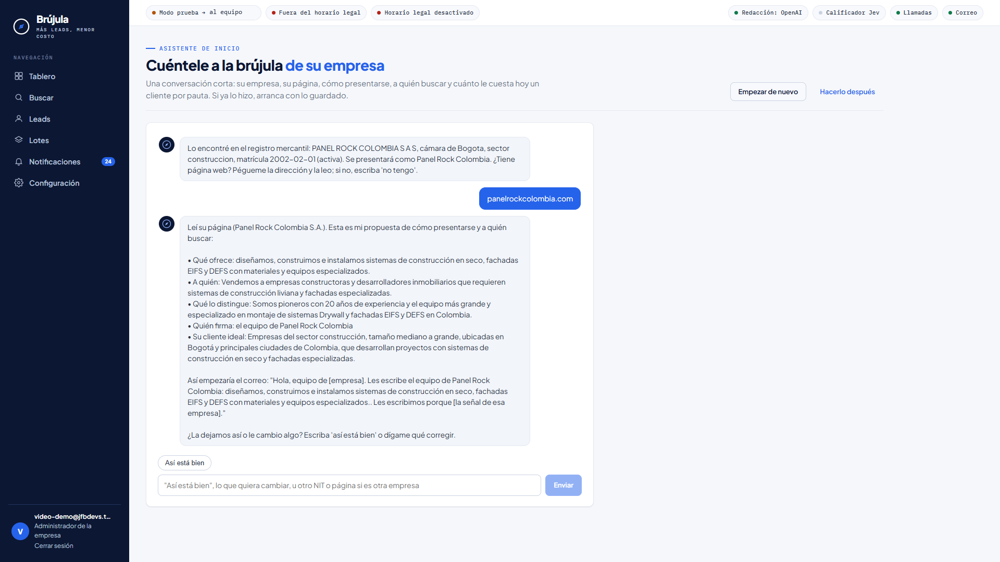
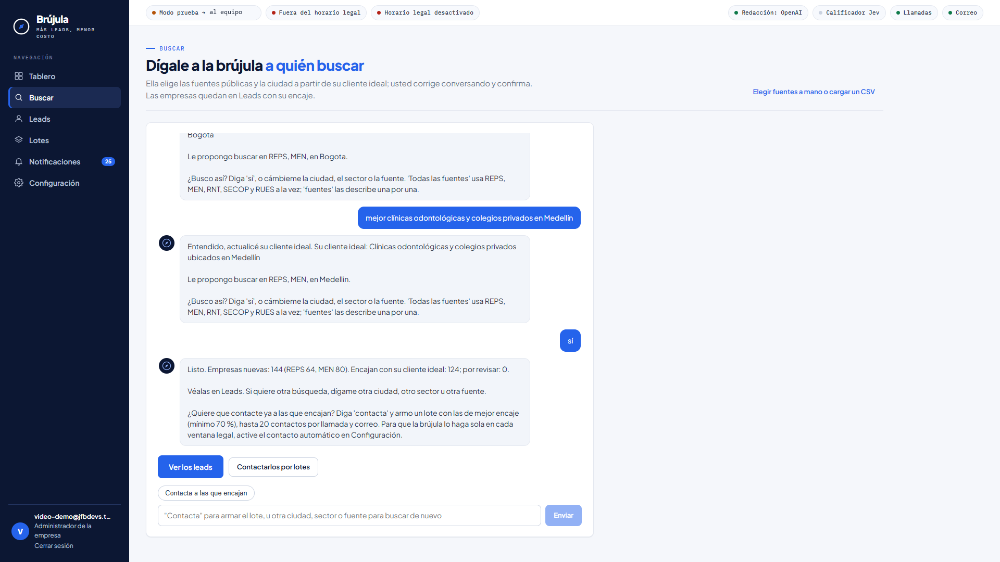
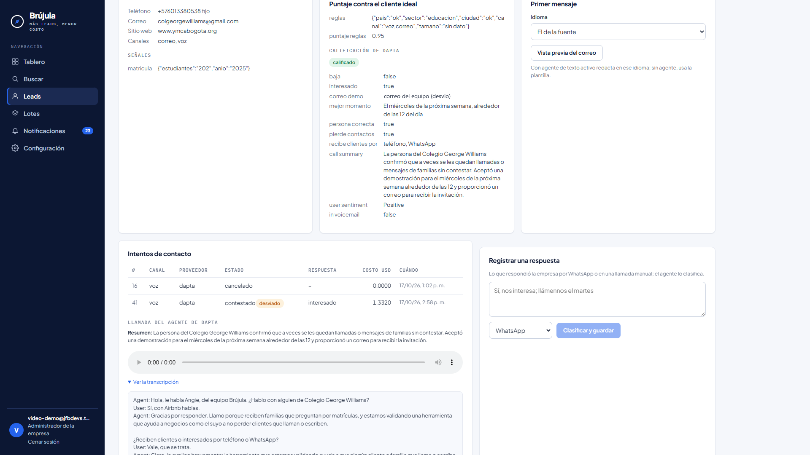
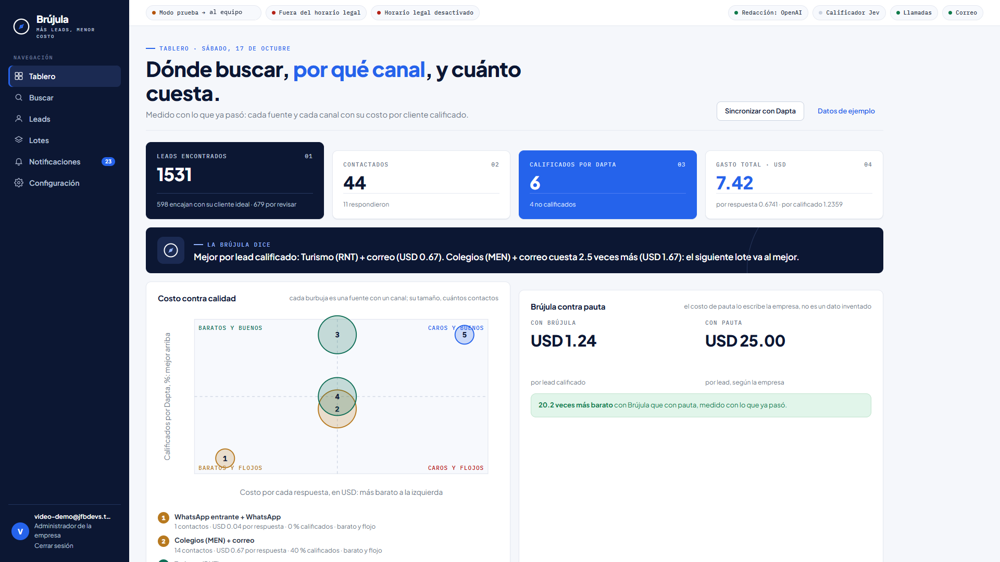
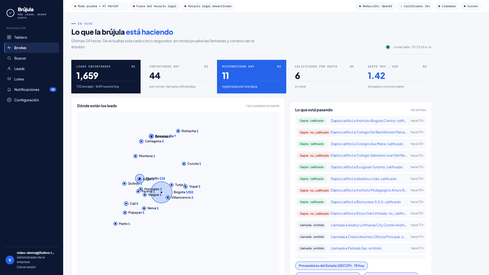
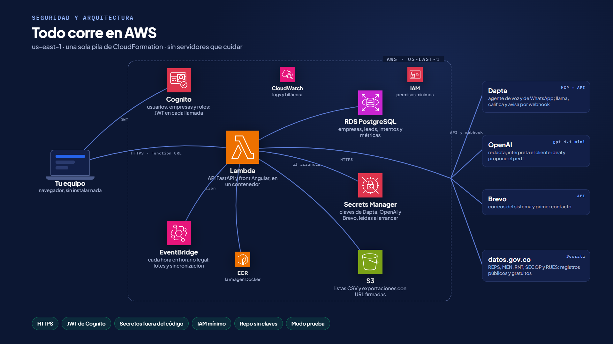
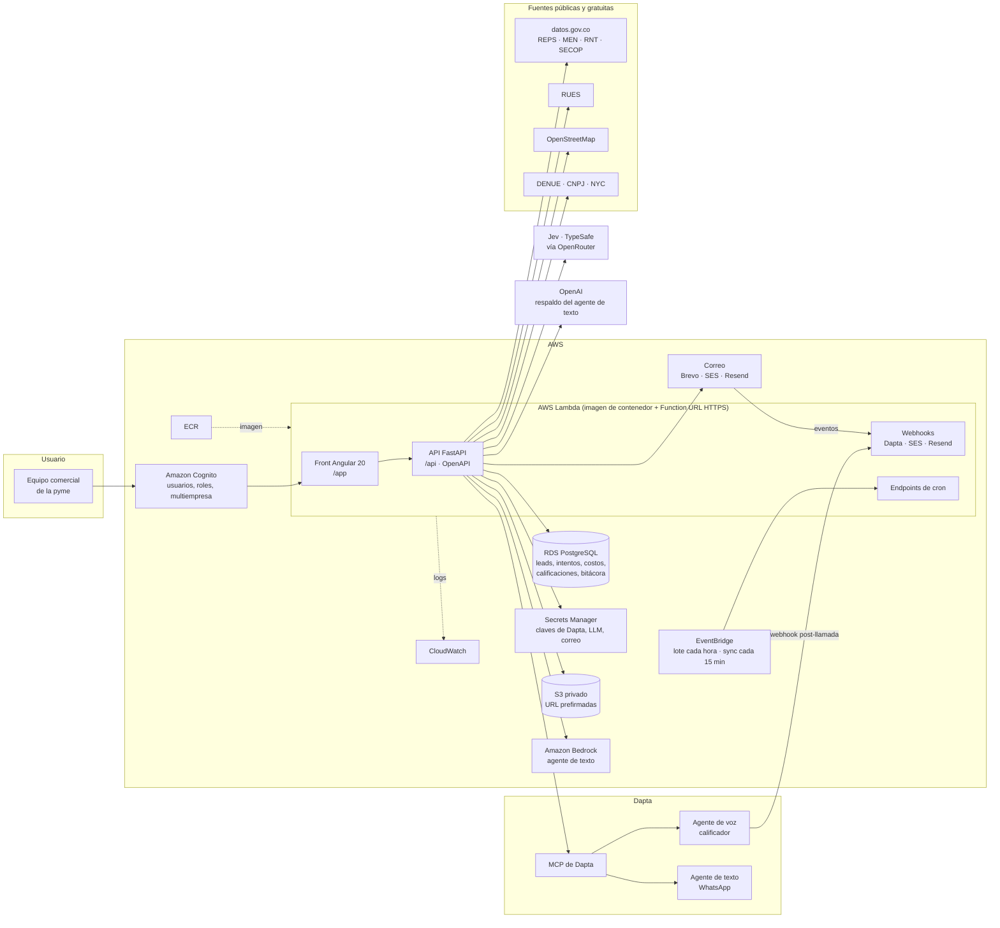

# Brújula

**Una plataforma serverless en AWS que encuentra empresas en registros públicos y gratuitos, las contacta con los agentes de Dapta (voz, correo y WhatsApp), mide cuánto cuesta cada lead y cada lead calificado por fuente y por canal, y aprende sola dónde conviene buscar el siguiente lote.**

Proyecto del equipo **JFB Devs** para el reto de Dapta en la Hackathon 30X (16 al 18 de octubre de 2026): *"Más leads, menor costo"*.

> 3 de cada 5 leads que llegan a Dapta preguntan si también les ayudan a conseguirlos. **Brújula es ese botón**: un producto que Dapta puede ofrecerle a sus propios clientes y que pone a trabajar a sus agentes desde el primer contacto.

| | |
|---|---|
| **Infraestructura** | 100 % AWS, serverless, como código (CloudFormation): Lambda + Function URL, RDS PostgreSQL, Cognito, Secrets Manager, S3, EventBridge, ECR, CloudWatch (SES y Bedrock soportados). Despliegue con un comando: `deploy/deploy.sh`. |
| **Integración con Dapta** | Por el MCP oficial (`https://mcp.dapta.ai/mcp`): crea el agente calificador y la secuencia, adjunta contactos, lee llamadas y conversaciones, recibe el webhook post-llamada y consulta el saldo de créditos. |
| **Producto** | Multiempresa con roles (Cognito), front Angular 20, API REST documentada (OpenAPI), cumplimiento de la Ley 2300 y modo prueba para demos reales sin tocar a terceros. |
| **Inteligencia** | Agente de texto (Bedrock, OpenAI u OpenRouter; hoy OpenAI) + Jev (TypeSafe) para el ICP y las respuestas, asistentes conversacionales para arrancar y para buscar, y un bandido multibrazo (Thompson sampling) que reparte cada lote por fuente × canal. Con reglas de respaldo: si un modelo falla, nada se cae. |

---

## Demo en vivo (para el jurado)

**URL:** https://a72puai2gx6o22p42j7uhkexfm0ihjed.lambda-url.us-east-1.on.aws/app/

La plataforma está desplegada y es **100 % funcional**: busca en registros públicos reales, contacta por correo y por el agente de voz de Dapta, mide costos reales y califica. Dos formas de entrar:

| Opción | Cómo | Qué se ve |
|---|---|---|
| **Registrarse** (la ideal) | *Crear mi empresa* en la pantalla de entrada: nombre de la empresa (o el NIT, y Brújula trae el nombre del RUES), correo y clave. Entra de inmediato y recibe un correo de bienvenida. | Su propio espacio vacío: el asistente de inicio le arma el perfil y el cliente ideal conversando, y Buscar le propone fuentes y trae empresas reales en segundos. |
| **Cuenta de jurado** | Usuario `jurado@jfbdevs.test` · clave `Brujula-Jurado-2026` (rol *usuario* de la empresa de demostración). | Todo lo que pasó durante el evento: más de 1.500 empresas encontradas, los lotes enviados, los correos reales, la llamada real del agente de Dapta y el lead que entró por WhatsApp. |

**Modo prueba (así está desplegada):** para no contactar a terceros durante la hackathon, todo el ciclo corre con los leads reales (búsqueda, cliente ideal, pitch con el nombre y las señales de cada empresa, lote, métricas), pero **la llamada del agente de Dapta se desvía a un único número de prueba del equipo y los correos a tres buzones del equipo**. Cada intento guarda el destino original y el desviado, y el encabezado de la aplicación lo muestra. Un lote nuevo, por tanto, sí produce una llamada real (al número de prueba) y gasta créditos de Dapta: eso es lo que mide el costo. Para contactar leads de verdad se despliega con `MODO_PRUEBA=0`.

**Evidencia que puede revisar en la cuenta de jurado:**
- **Leads → Colegio George Williams** (fuente MEN): llamada real del agente de voz de Dapta el 17 de octubre, 184 segundos, USD 1,33, resultado *interesado* y *calificado*, con el resumen, las variables extraídas, la transcripción y la grabación.
- **Leads → WHATSAPP ENTRANTE 772233**: conversación real que entró por la línea de WhatsApp Business conectada al agente de texto de Dapta.
- **Lotes**: los lotes 1 a 7 con su reparto por fuente y canal y la explicación de la brújula; **Tablero**: costo por respuesta y por calificado, el cuadrante costo contra calidad y Brújula contra pauta; **En vivo**: lo que va pasando, con los leads por ciudad.
- Bitácora exportable (`Leads → Exportar CSV`, `/api/exportar/bitacora`) con cada búsqueda, lote, envío, excepción de horario y registro.

Nota honesta: en esta cuenta nueva de AWS, Amazon Bedrock aún no está habilitado (verificación de cuenta pendiente), así que el agente de texto corre hoy en OpenAI (`gpt-4.1-mini`); el código soporta Bedrock, OpenAI, OpenRouter y reglas, y `GET /api/estado` dice cuál está activo. El primer mensaje saliente por WhatsApp espera la aprobación de la plantilla en Meta y se simula; lo entrante sí es real. El video de demostración se entrega en la plataforma de la hackathon; lo que muestra, en orden, está en [`docs/guion-video.md`](docs/guion-video.md).

---

## Estructura del repositorio

```
brujula/                      Backend: Python 3.12, FastAPI, SQLModel
  web/app.py                  API REST (/api/*, OpenAPI en /api/docs), webhooks (Dapta, SES, Resend), cron y el front servido en /app/
  models.py · db.py           Modelo de datos: empresas, leads, intentos (con costo), lotes, calificaciones, bitácora, notificaciones
  sources/                    Conectores: co_reps, co_men, co_rnt, co_secop, co_rues (datos_gov), osm, otros_paises (DENUE, CNPJ, NYC), csv_propio, discover
  normalize.py · dedupe.py    Teléfonos a E.164, correos, dominios, NIT; deduplicación NIT > dominio > teléfono > nombre parecido
  ingest.py                   Corre un conector, guarda los leads de una empresa, registra el costo de encontrar y deduplica
  icp.py · agente.py          Cliente ideal: reglas + Jev; agente de texto (Bedrock / OpenAI / OpenRouter / reglas)
  asistente.py                Los dos chats: inicio (perfil + cliente ideal) y buscar (fuentes, ciudades, lotes)
  perfil.py · mensajes.py     RUES por NIT y lectura de la página web; plantillas es/pt/en y correo HTML
  bandit.py                   Thompson sampling por fuente × canal: dónde buscar el siguiente lote
  pipeline.py                 Lotes, envío por canal, sincronización con Dapta (llamadas y conversaciones)
  channels/                   correo.py (Brevo / SES / Resend), voz_dapta.py, whatsapp.py
  dapta_mcp.py · dapta_setup.py   Cliente del MCP de Dapta (preview -> commit); creación del agente de voz y la secuencia
  compliance.py               Ley 2300 (ventana, festivos de Colombia), RNE, overrides con usuario y motivo
  metrics.py                  Costo por lead encontrado, CPL, CPLQ, cuadrante costo contra calidad, Brújula contra pauta
  empresas.py · auth.py       Multiempresa, perfil comercial; Cognito (JWT, roles)
  storage.py · notificaciones.py   S3 con URL prefirmadas (o disco local); avisos en la app y por correo
  testset.py · config.py      Set de 50 empresas con duplicados trampa; variables de entorno y tarifas
front/                        Angular 20 (standalone + signals): tablero, en vivo, inicio y buscar (chats), leads, lotes, notificaciones, configuración, login, registro
deploy/                       cloudformation.yml (Lambda, RDS, Secrets, S3, EventBridge), cognito.yml, deploy.sh, iam-politica-despliegue.json
tests/                        41 pruebas pytest en 14 archivos
docs/                         arquitectura-aws.png, arquitectura.md, PDFs, capturas/ y lo que muestra el video
Dockerfile                    Dos etapas: Node compila el front, Python sirve API + front con Lambda Web Adapter
cli.py                        fuentes, fetch, dedupe, score, descubrir, stats, lote, sync, simular, metricas, prueba, dapta-setup, rne, web
icp.json · .env.example       Cliente ideal de ejemplo; variables de entorno con marcadores (sin claves)
```

### Pantallas (capturas reales del despliegue)

| | |
|---|---|
|  **Asistente de inicio:** NIT buscado en el RUES, página leída y propuesta de perfil y cliente ideal. |  **Buscar:** la brújula propone fuentes y ciudad; 144 empresas nuevas en Medellín y la oferta de contactarlas. |
|  **Detalle del lead:** la llamada real del agente de voz de Dapta, con calificación, variables, resumen, grabación y transcripción. |  **Tablero:** costo por respuesta y por calificado, cuadrante costo contra calidad y Brújula contra pauta. |
|  **En vivo:** contadores de 24 horas, feed de lo que pasa y mapa de leads por ciudad. | |

---

## 1. La promesa de valor

### Para la pyme: clientes sin depender de la pauta
Una pyme colombiana que quiere más clientes hoy tiene dos caminos: pagar pauta (Meta, Google) o buscar a mano. Brújula es un tercer camino:

1. **Conversa con el asistente de inicio**: da su nombre y NIT (lo busca en el RUES), su página web (la lee) y a quién le quiere vender, en sus palabras: *"clínicas odontológicas en Bogotá con más de 10 empleados que agendan por WhatsApp"*. El agente arma su perfil comercial y su cliente ideal.
2. **Brújula propone dónde buscar y busca** en registros públicos (salud, educación, turismo, contratación pública, cámaras de comercio, mapas), también por chat; quita los duplicados y puntúa cada empresa contra ese cliente ideal.
3. **Los agentes de Dapta hacen el primer contacto** en nombre de la pyme (no de Brújula), por el canal que tenga cada empresa y dentro del horario legal.
4. **La pyme ve cuánto le costó cada cliente calificado**, por fuente y por canal, y Brújula reparte el siguiente lote hacia lo que mejor funcionó.

### Por qué es más accesible que la pauta

| | Pauta digital | Brújula |
|---|---|---|
| **Presupuesto para empezar** | Hay que fondear campañas y competir en una subasta antes de ver el primer lead. | Las fuentes son públicas y gratuitas; se paga por intento de contacto (créditos de Dapta, correo, mensaje). |
| **A quién llega** | A quien el algoritmo decida mostrarle el anuncio. | A empresas concretas, con nombre, NIT, sector y ciudad, filtradas contra el cliente ideal antes de gastar un peso. |
| **Qué se paga** | Impresiones y clics, se conviertan o no. | Contactos a leads que ya pasaron el filtro del perfil. |
| **Qué se mide** | Clics y formularios, en el panel de cada plataforma. | Costo por lead encontrado, CPL y **CPLQ (costo por lead calificado por Dapta)**, por fuente y canal, en un solo tablero. |
| **Quién aprende** | La plataforma de anuncios, con los datos del anunciante. | La pyme: el reparto de cada lote se explica en una frase y queda en la bitácora. |
| **Iniciativa** | Espera a que el cliente haga clic. | Sale a buscarlo: es prospección activa, B2B. |

El tablero lo pone en números con **Brújula contra pauta**: la empresa escribe cuánto le cuesta hoy un lead por pauta y Brújula lo compara con su costo por lead calificado medido, con el factor de ahorro.

Brújula le da a la pyme que no puede o no quiere pagar pauta una forma medible de conseguir clientes, y a la que ya la paga, una referencia de cuánto debería costarle un lead bueno y un canal más para complementarla.

### Para Dapta: una nueva línea de producto que consume sus agentes
- **Responde la pregunta que ya le hacen** 3 de cada 5 leads: *"¿también me ayudan a conseguir clientes?"*.
- **Cada lote consume créditos de Dapta**: llamadas del agente de voz, conversaciones del agente de texto por WhatsApp y calificación. Brújula convierte la prospección en uso de la plataforma de Dapta.
- **Ya es multiempresa**: cada empresa conecta su propia clave MCP, su agente y su secuencia de Dapta. Dapta podría ofrecerlo a sus clientes como complemento sin cambiar su producto.
- **Le entrega a Dapta leads ya filtrados**, con el pitch armado con el nombre y las señales de cada empresa, para que su agente calificador trabaje sobre lo que vale la pena.

---

## 2. Qué pide el reto y cómo lo cumple

| Requisito del reto | Qué hace Brújula | Estado |
|---|---|---|
| **Buscar en 2+ fuentes públicas y gratuitas** | Colombia: REPS (prestadores de salud), MEN (colegios), Registro Nacional de Turismo, SECOP II (proveedores del Estado), RUES (Confecámaras) y OpenStreetMap. Fuera de Colombia (solo encontrar): DENUE (México), CNPJ (Brasil) y licencias de negocios de Nueva York. | Funciona con datos reales (datos.gov.co, Overpass y las API de cada país). |
| **Un solo lugar, sin duplicados** | Normaliza teléfonos a E.164 (repara fijos de 7 dígitos), correos y nombres; deduplica por NIT, dominio, teléfono y nombre parecido en la misma ciudad (`rapidfuzz`). Un set de 50 empresas con duplicados trampa mide la deduplicación (`cli.py prueba`). | Funciona. |
| **Filtrar por el perfil de cliente ideal** | Reglas (país, sector, ciudad, canal, tamaño) + Jev (TypeSafe, vía OpenRouter) con probabilidad calibrada. 0,7 o más pasa; de 0,4 a 0,7 lo decide una persona en el tablero; menos se descarta. | Funciona; sin clave de Jev, solo reglas. |
| **Primer mensaje y registro de la respuesta** | Voz con el agente de Dapta (secuencia vía MCP), correo (SES o Resend) con botones *me interesa / no / baja*, y WhatsApp con el agente de texto de Dapta. Cada respuesta se clasifica (interesado, después, no, baja). | Voz y correo: reales. WhatsApp: entrante real; el primer mensaje saliente espera la aprobación de la plantilla en Meta. |
| **Tablero con leads y CPL por canal** | Front Angular con tablero, leads (ordenables por encaje o por calor), lotes y bitácora: costo por lead encontrado (por fuente), CPL (por canal) y CPLQ (por canal y por fuente × canal), más speed-to-lead, embudo y Brújula contra pauta. | Funciona. |
| **Solo datos públicos de empresas y ley de datos** | Solo personas jurídicas y canales corporativos; lista de exclusión (RNE de la CRC y bajas); atribución de cada fuente y respeto de sus términos de uso. | Funciona. |
| *Deseable:* **enviar los leads al agente de Dapta** | Los leads que responden entran a la secuencia del calificador de Dapta; el resultado vuelve por webhook y por `find_qualified_leads`. | Funciona. |
| *Deseable:* **comparar canales por CPL y % de calificados** | Porcentaje de calificados por canal y un **cuadrante costo contra calidad** (costo por respuesta contra % de calificados, una burbuja por fuente y canal con su volumen): se ve de un vistazo qué canal trae leads baratos y cuál trae leads buenos. | Funciona. |
| *Deseable:* **costo por lead calificado por canal** | CPLQ con el costo real de cada intento (créditos de Dapta cuando el proveedor lo entrega; tarifa publicada cuando no). | Funciona. |
| **Extra: pantalla en vivo** | `/app/en-vivo`: contadores de 24 horas, feed de lo que pasa (búsquedas, lotes, envíos, respuestas, calificaciones) y mapa de leads por ciudad, para el Demo Day. | Funciona. |
| **Extra: decidir dónde buscar** | La brújula: bandido multibrazo (Thompson sampling) por fuente × canal. Recompensa = leads calificados por dólar, piso de exploración del 15 % y una explicación en una frase por lote. Corre cada hora con EventBridge. | Funciona. |

---

## 3. Arquitectura en AWS



Toda la plataforma corre en AWS, sin servidores que administrar y con costo cercano a cero en reposo. La infraestructura está declarada como código en `deploy/cloudformation.yml` y `deploy/cognito.yml`, y se levanta con `deploy/deploy.sh`.



### Cada pieza y por qué

| Servicio | Para qué | Por qué este |
|---|---|---|
| **AWS Lambda** con imagen de contenedor, **Function URL** y Lambda Web Adapter | Front, API, webhooks de Dapta y de correo, y endpoints de cron, todo en una sola imagen. | Sin servidores ni balanceadores, HTTPS propio sin dominio y costo cero en reposo. La misma imagen corre en cualquier contenedor (Docker) gracias al Web Adapter. |
| **Amazon ECR** | Registro de la imagen (front + backend compilados juntos). | Construcción reproducible en dos etapas (Node para Angular, Python para la API). |
| **Amazon RDS PostgreSQL** | Leads, intentos con su costo, calificaciones, lotes, bitácora y notificaciones, aislados por `empresa_id`. | Lambda no tiene disco persistente. El mismo modelo (SQLModel) corre en SQLite en desarrollo y en las pruebas. |
| **Amazon Cognito** | Usuarios, roles (`usuario`, `admin`, `superadmin`) y empresa de cada usuario (`custom:empresa_id`, `custom:rol`). | Login propio en español contra la API de Cognito (la clave nunca pasa por Brújula), cambio de clave en el primer ingreso y recuperación por código. La empresa y el rol los fija siempre el servidor. |
| **AWS Secrets Manager** | Clave MCP de Dapta, claves de los modelos, correo, cron y la URL de la base. | Nada sensible en la imagen ni en variables planas; la Lambda lo lee al arrancar. |
| **Amazon EventBridge** (API destinations) | Regla 1: lote cada hora dentro de la ventana legal (L-V y sábados, hora Bogotá). Regla 2: sincronización con Dapta cada 15 minutos. | El ciclo "encontrar, contactar, medir, reasignar" corre solo, sin un proceso vivo. La app vuelve a validar la ventana: EventBridge propone, el cumplimiento dispone. |
| **Amazon S3** | Subidas desde el navegador (lista propia, RNE) y exportaciones (leads, intentos, bitácora). | URL prefirmadas de 15 minutos: el servidor nunca recibe ni sirve el archivo. Bucket privado; las subidas caducan a los 30 días. |
| **Correo: Brevo, Amazon SES o Resend** (`EMAIL_PROVIDER`) | Correos a leads (con botones de respuesta) y correos del sistema (bienvenida, avisos). | Hoy Brevo, porque SES está en sandbox en esta cuenta nueva (solo destinatarios verificados). SES conserva los eventos de entrega, apertura y clic por SNS; los tres proveedores comparten la misma interfaz. |
| **Amazon Bedrock** (API converse) | Agente de texto: interpreta el cliente ideal, redacta el primer mensaje con las señales del lead y explica decisiones. | Modelo configurable (por defecto Claude Haiku 5.5). Si la cuenta no lo tiene habilitado, el mismo agente corre en OpenAI o en OpenRouter y, sin modelo, por reglas. |
| **Amazon CloudWatch** | Logs de la Lambda. | Viene integrado. |
| **IAM** | Política mínima para el usuario que despliega (`deploy/iam-politica-despliegue.json`) y rol propio de la función. | Mínimo privilegio. |

Fuera de AWS, a propósito: **Dapta** (es el producto del reto), **Jev** (el modelo del organizador, barato y rápido para decisiones repetitivas), **OpenAI** como respaldo del agente de texto y las **fuentes públicas**, que se citan con su licencia.

### Flujo de datos
1. **Encontrar**: conector → registro normalizado → lead (principal o duplicado) → costo de descarga prorrateado.
2. **Puntuar**: reglas + Jev → `icp_score` e `icp_estado`; los dudosos los decide una persona.
3. **Lote**: cumplimiento (ventana, exclusión, persona jurídica) → la brújula reparte por fuente × canal → intentos → cada canal envía y guarda estado, costo y referencia.
4. **Respuestas**: correo por clic o por eventos de SES y Resend; voz por `list_calls` y el webhook post-llamada; WhatsApp por las conversaciones del agente de texto.
5. **Calificar**: los que respondieron entran a la secuencia del calificador de Dapta; `find_qualified_leads` y el análisis post-llamada cierran la calificación.
6. **Medir**: costo por lead encontrado, CPL, CPLQ, speed-to-lead, embudo y la recomendación del siguiente lote.

---

## 4. Integración con Dapta

Brújula habla con Dapta por su **MCP oficial** (`https://mcp.dapta.ai/mcp`, cabecera `x-api-key`). No hay scraping ni integraciones no oficiales.

| Qué hace Brújula en Dapta | Herramientas del MCP |
|---|---|
| Crea y ajusta el **agente de voz calificador** (propósito, voz colombiana, variables post-llamada: interesado, pierde_contactos, mejor_momento, correo_demo, baja) con webhook a `/webhook/dapta`. | `create_voice_agent`, `commit_update_voice_agent`, `list_voices`, `list_agents` |
| Crea la **secuencia** con el horario de la Ley 2300 y la abre temporalmente cuando un usuario autoriza un override (queda en la bitácora y se restaura sola). | `commit_create_sequence`, `commit_update_sequence_rules`, `list_sequences` |
| **Entrega los leads** a la secuencia con el pitch armado con el nombre y las señales de cada empresa, y la llamada se presenta en nombre de la pyme (`{{remitente}}`, `{{propuesta}}`). | `commit_attach_sequence_contacts`, `list_sequence_contacts`, `get_sequence_contact_attempts` |
| **Lee resultados**: llamadas con resumen, variables, transcripción y grabación (visibles en el detalle de cada lead), conversaciones de WhatsApp y leads calificados. | `list_calls`, `get_call`, `list_conversations`, `get_conversation`, `find_qualified_leads` |
| **Mide el costo real** en créditos. | `get_my_balance` |

`python cli.py dapta-setup` deja el agente y la secuencia listos en una cuenta nueva. La secuencia se activa en el panel de Dapta (el MCP no arranca llamadas por diseño de Dapta).

### Cómo podría usarlo Dapta
- **Como complemento para sus clientes**: cada empresa en Brújula guarda su propia clave MCP, agente y secuencia (Configuración → *Dapta de la empresa*). Un cliente de Dapta entra, describe a quién le vende y sus agentes empiezan a trabajar sobre leads nuevos.
- **Como fuente de leads para sus agentes**: la API REST (`/api/*`, OpenAPI en `/api/docs`) permite que otro sistema pida búsquedas, lea leads puntuados y consulte métricas.
- **Como tablero de rentabilidad por canal**: Dapta puede mostrarle a cada cliente cuánto le cuesta un lead calificado por voz, por correo y por WhatsApp, con sus propios créditos como base del cálculo.

---

## 5. Fortalezas técnicas

- **Serverless de punta a punta y como código.** CloudFormation para todo (incluido Cognito), un script de despliegue reanudable (`SALTAR_IMAGEN=1 TAG=<etiqueta>`) y una sola imagen para front y API. La Function URL incluye los dos permisos que Lambda exige desde octubre de 2025.
- **Costo real por intento.** Cada contacto guarda lo que costó: créditos de Dapta cuando el proveedor lo entrega y tarifa publicada cuando no (Meta, SES, OpenRouter). El CPLQ no es una estimación de tablero: sale de la suma de intentos reales.
- **IA híbrida con respaldo.** Bedrock para lo creativo (con OpenAI y OpenRouter como respaldo), Jev para las decisiones rápidas con probabilidad calibrada y reglas cuando falta un modelo. Cada resultado dice qué motor lo produjo (`GET /api/estado`).
- **Aprendizaje explicable.** El bandido (Thompson sampling sobre Beta por fuente × canal) tiene priors declarados, piso de exploración del 15 % y una frase que explica cada reparto; se recalcula con cada resultado que vuelve de Dapta y de los canales.
- **Multiempresa de verdad.** Aislamiento por `empresa_id` en todas las tablas, roles en Cognito, registro propio (empresa + admin en un paso) y alta de usuarios por un admin, todo en la bitácora.
- **Cumplimiento desde el diseño.** Ventana de la Ley 2300 con los festivos de Colombia calculados para cualquier año (fijos, Ley Emiliani y los que dependen de la Pascua), override explícito con usuario y motivo, lista de exclusión (RNE y bajas), solo personas jurídicas y atribución de fuentes.
- **Modo prueba para demos reales.** Todo el ciclo corre con leads reales, pero la llamada y el correo se desvían al equipo; el intento guarda el destino original y el desviado. Ningún tercero recibe nada.
- **Seguridad.** Secretos en Secrets Manager, JWT de Cognito en cada llamada, bucket privado con URL prefirmadas y una política de IAM mínima.
- **Tres idiomas.** Español, portugués e inglés según el país de la fuente, configurable por empresa.
- **Probado.** 41 pruebas automáticas (`pytest`) de deduplicación, normalización, ICP, bandido, cumplimiento, Ley 2300 y festivos, modo prueba, idiomas, override de Dapta, almacenamiento, WhatsApp, los dos asistentes, correo por Brevo y autenticación.

### Stack
**Backend:** Python 3.12, FastAPI, SQLModel, httpx, boto3, rapidfuzz, phonenumbers, PyJWT. **Front:** Angular 20 (componentes standalone y signals). **Datos:** PostgreSQL (RDS) en la nube, SQLite en desarrollo. **IA:** Amazon Bedrock, OpenAI, Jev (TypeSafe) por OpenRouter. **Contacto:** Dapta (voz y WhatsApp) por MCP; correo por Brevo, Amazon SES o Resend.

---

## 6. Cómo correrlo

### Local
```bash
python -m venv .venv && .venv/Scripts/pip install -r requirements.txt   # Windows; en Linux .venv/bin/pip
cp .env.example .env                                                     # complete las claves que tenga
python cli.py fetch reps --ciudad BOGOTA --limite 200
python cli.py fetch rnt  --ciudad BOGOTA --limite 200
python cli.py fetch men  --ciudad BOGOTA --limite 200
python cli.py score                     # ICP (Jev si hay clave; si no, reglas)
python cli.py lote --n 30               # la brújula reparte y envía (dentro de la ventana legal)
python cli.py sync                      # pasa a Dapta los que respondieron y lee las llamadas
python cli.py metricas
python cli.py web                       # API y tablero en http://localhost:8000
cd front && npm install && npx ng serve # front Angular en http://localhost:4200
```

Más comandos: `python cli.py -h` (`prueba` mide la deduplicación con 50 empresas y duplicados trampa; `descubrir` busca datasets con columnas de contacto en catálogos abiertos; `dapta-setup` crea el agente de voz y la secuencia en Dapta; `rne` carga la lista de exclusión).

Pruebas: `pip install -r requirements-dev.txt && python -m pytest`.

Sin credenciales, cada canal corre en **modo simulado** y lo dice. El botón **"Simular resultados"** del tablero inventa respuestas y calificaciones sobre intentos simulados para enseñar el tablero; se marca como simulado en los datos y no es evidencia de nada.

### En AWS
`deploy/deploy.sh` construye la imagen (front incluido), la sube a ECR, despliega la pila principal, crea la pila de Cognito con las URL de retorno y vuelve a actualizar la pila principal con los ids de Cognito y la URL pública. Detalle y decisiones en [`docs/arquitectura.md`](docs/arquitectura.md).

---

## 7. Detalles de operación

### Modo prueba: demo real sin tocar a terceros
Con `MODO_PRUEBA=1` (valor con el que se despliega) todo el ciclo corre con los leads reales —búsqueda, ICP, lote, pitch con el nombre y las señales de cada empresa, métricas—, pero el contacto se **desvía**: la secuencia de Dapta marca a `TELEFONO_PRUEBA` (una llamada por lote, con las variables de la empresa real) y los correos van a `CORREOS_PRUEBA` (identidades verificadas en SES). El intento guarda `detalle.desvio = {original, destino}` y el cuerpo del correo empieza con "Prueba: este correo iba para …". Un canal sin destino queda `omitido` sin costo; ningún lead recibe nada. `CRON_LOTES=DISABLED` apaga las reglas de EventBridge que lanzan el lote cada hora. La aplicación muestra "MODO PRUEBA → número" en el encabezado; para contactar de verdad se despliega con `MODO_PRUEBA=0`, sin destinos y `CRON_LOTES=ENABLED`.

El override de horario por usuario (Ley 2300) también abre el horario de la secuencia de Dapta: al enviar un lote con override que lleve llamadas, `ejecutar_lote` amplía el día de hoy en la secuencia (06:00 a. m. a 11:59 p. m., hora Bogotá) y lo anota en la bitácora (`override_dapta`, con usuario, motivo y hora de vencimiento); dos horas después, la sincronización restaura el horario legal (`override_dapta_cierre`). Cada empresa puede además desactivar el horario en Configuración bajo su responsabilidad (`respetar_ley_2300`), con constancia de quién lo cambió.

### WhatsApp
La línea de WhatsApp Business (Meta) está conectada a Dapta y asignada al agente de texto "Brújula · chat" (`DAPTA_TEXT_AGENT_ID`), que atiende en español con el mismo guion de calificación que el de voz. Lo **entrante es real**: `pipeline.sincronizar_chats` (cada 15 minutos, en "Sincronizar con Dapta" y tras el webhook post-conversación) lee las conversaciones del agente, las liga al lead por teléfono cuando Dapta deja ver los dígitos del identificador y, si no, a un lead "WhatsApp entrante", clasifica lo que escribió la persona (interesado, después, no interesado, baja) y guarda el costo en créditos. El **primer mensaje saliente** exige una plantilla aprobada por Meta en esa línea; está en revisión y, mientras tanto, el canal lo simula y lo dice.

### Cómo se presenta cada empresa y el asistente de inicio

Los mensajes hablan en nombre de la empresa que usa Brújula, no de Brújula: cada empresa tiene un perfil comercial (`config.perfil`: nombre con el que se presenta, qué ofrece, a quién, qué la distingue, quién firma, NIT, página) y con él se arman el correo, el WhatsApp y las variables de la llamada de Dapta (`{{remitente}}`, `{{propuesta}}`). La empresa de demostración habla como Brújula. El perfil se llena conversando con el **asistente de inicio** (`/app/inicio`, `POST /api/asistente`): en cuatro turnos pide nombre y NIT (lo busca en el RUES de datos.gov.co), la página web (la lee: título, descripción y texto), propone cómo presentarse y el cliente ideal (con el agente de texto, o con reglas si no hay agente), acepta correcciones y pregunta cuánto le cuesta hoy un lead por pauta; al final guarda perfil, cliente ideal y costo de pauta. Lo mismo se puede hacer con botones en Configuración y, opcionalmente, el NIT en el registro.

**Buscar también es un chat** (`/app/buscar`, `POST /api/asistente/buscar`). La brújula lee el cliente ideal y propone en qué fuentes públicas buscar (REPS para salud, MEN para educación, RNT para turismo, SECOP para el resto) y en qué ciudades; la persona corrige conversando ("también en Medellín", "reps y men", "clínicas dentales en Cali", "fuentes" para ver todas) y confirma con "sí". Un cliente ideal nuevo escrito ahí se interpreta con el agente y se guarda. El modo manual (marcar fuentes, parámetros por fuente, cargar CSV o exclusiones) sigue en `/app/buscar/manual`. El asistente de inicio, al terminar, ofrece buscar de una vez con ese mismo plan.

**Correo: dos caminos.** Los correos a leads salen por `channels/correo.py` y, en modo prueba, se desvían a los correos del equipo (nunca a un tercero). Los correos del sistema (bienvenida al registrarse, avisos a la empresa) salen por `enviar_transaccional` al destinatario real, sin desvío. Proveedor por `EMAIL_PROVIDER`: `brevo` (API v3, clave `BREVO_API_KEY`, remitente validado en Brevo), `ses` (exige identidades verificadas mientras la cuenta esté en sandbox) o `resend`. Las claves temporales y el "olvidé mi clave" los manda Cognito con su propio remitente.

**Contactar: a pedido o automático.** Después de buscar, el chat ofrece "contacta": arma un lote con las empresas que encajan (encaje mínimo `config.umbral_contacto`, 70 % por defecto, la empresa puede subirlo), hasta `presupuesto_lote` contactos, repartidos entre fuentes y canales por el bandido, y lo envía. Lo mismo hace el botón de Lotes. Con `config.contacto_automatico` activo (Configuración), el cron de la ventana legal (`/cron/lote`, cada hora) arma y envía lotes solo para esa empresa; apagado, el cron la salta. En el tablero, el cuadrante "Costo contra calidad" numera cada fuente con su canal y lo explica en una leyenda (contactos, costo por respuesta, % calificados y zona: barato y bueno, caro y bueno, barato y flojo, caro y flojo); los nombres son legibles (Turismo (RNT) + correo), no claves.

**Pantalla en vivo** (`/app/en-vivo`, `GET /api/en-vivo`): para el Demo Day. Contadores de las últimas 24 horas (encontrados, contactados, respondieron, calificados por Dapta, gasto), el feed de lo que va pasando (búsquedas, lotes, envíos, respuestas, calificaciones, excepciones de horario) con enlace a cada lead, y un mapa de puntos de Colombia con los leads por ciudad (las fuentes que no traen ciudad se cuentan aparte). Se refresca sola cada cinco segundos.

**Encaje y calor.** Son dos cosas distintas. El encaje (0 a 100 %) mide cuánto se parece el lead al cliente ideal con lo que ya se sabe de él (sector, ciudad, tamaño y señales como página, teléfono o correo); Brújula contacta primero a los que encajan. Lo "caliente" no se adivina: sale de lo que hizo el lead después de contactarlo (contactado, respondió, calificado por el agente de Dapta con sus variables). En Leads se ordena por mejor encaje, más calientes o últimos agregados. La búsqueda la lanza la persona desde Buscar (o cargando un CSV); el contacto por lotes sí puede programarse dentro del horario legal, y las respuestas de Dapta llegan por webhook y por una sincronización cada 15 minutos.

El tablero muestra con eso dos cosas que el reto pide: el **porcentaje de calificados por canal** y un **cuadrante costo contra calidad** (costo por respuesta contra % de calificados, una burbuja por fuente y canal con su volumen), y **Brújula contra pauta**: el costo por lead que la empresa escribió frente al costo por lead calificado medido, con el factor de ahorro. En el detalle de cada lead se ve el agente de Dapta trabajando: resumen, variables extraídas, transcripción y grabación de la llamada (la sincronización las trae de `get_call`).

### Idiomas de los mensajes
Cada fuente tiene un idioma por defecto según su país (Colombia y México en español, Brasil en portugués, Nueva York en inglés) y la empresa puede fijar otro por fuente en Configuración (`config.idiomas`). Las plantillas de correo y WhatsApp existen en los tres idiomas (`brujula/mensajes.py`); con agente de texto, él redacta directamente en el idioma del lead. En el detalle de cada lead se previsualiza el mensaje (`GET /api/lead/{id}/mensaje?idioma=pt`). Los correos del sistema (clave temporal, código de recuperación) salen de Cognito con la misma marca (`deploy/cognito.yml`).

### Empresas, usuarios y roles
Cada empresa es un espacio aparte (`empresa_id` en leads, lotes, intentos, calificaciones, costos, bitácora y notificaciones). Tres roles en Cognito (`custom:rol`): **usuario** trabaja con los leads de su empresa; **admin** además configura la empresa (ICP, canales, Dapta, horario) y agrega personas a su empresa (`POST /api/usuarios`); **superadmin** crea empresas (`POST /api/empresas`), crea usuarios en cualquiera y puede mirar otra empresa con `?empresa=ID`. Dos formas de entrar: **registro propio** (`/app/registro` → `POST /api/registro`: el servidor crea la empresa y su primer usuario como admin y la persona entra de inmediato) y **alta por un admin** (clave temporal por correo). El User Pool sigue en "solo creación por administrador" y el cliente de Cognito solo puede escribir `email`: la empresa y el rol los fija siempre el servidor. Cada alta queda en la bitácora. La empresa 1 es la de demostración y existe siempre.

### Agente y notificaciones
- **Agente de texto** (Bedrock, API converse; modelo por `BEDROCK_MODEL`): convierte el cliente ideal escrito en criterios (`POST /api/icp/interpretar`), redacta el primer mensaje de cada lead con su señal y explica decisiones en una frase. Si la cuenta de AWS no tiene Bedrock habilitado, el mismo agente corre en OpenAI (`OPENAI_MODEL`, por defecto `gpt-4.1-mini`) o en Amazon Nova por OpenRouter (`LLM_OPENROUTER_MODEL`).
- **Jev (TypeSafe, por OpenRouter)**: puntúa cada lead contra el ICP y clasifica respuestas libres (interesado, no, después, equivocado, baja).
- Sin ningún modelo de texto o sin Jev, mandan las reglas y palabras clave: nada se cae y el resultado dice qué motor se usó.

Notificaciones por empresa (`/api/notificaciones`): búsqueda terminada, lote enviado, lead que respondió, calificado por Dapta y baja; en la app y por correo cuando SES está configurado.

### API y front
La API JSON vive en `/api/*` (OpenAPI en `/api/docs`) con CORS configurable (`CORS_ORIGINS`). El front Angular vive en `front/`: el `Dockerfile` lo compila en una primera etapa (`ng build --base-href /app/`) y la misma aplicación lo sirve en `/app/` (la raíz redirige allí), con lo que API y front comparten origen y no hace falta CloudFront ni dominio. El front lee su configuración de `/app/config.json` (la genera el servidor con los ids de Cognito) y las llamadas a la API llevan el JWT en `Authorization: Bearer`. La página alojada de Cognito (código con PKCE, callback `/app/callback`) queda como alternativa al login propio. `deploy/front.yml` y `deploy/front.sh` son la variante en S3 + CloudFront.

### Archivos: S3 con URL prefirmadas
Subidas (lista propia de la pyme en CSV o el RNE de la CRC): `POST /api/archivos/url-subida` devuelve una URL prefirmada de PUT válida 15 minutos y una clave; el navegador sube directo a S3 y luego llama a `POST /api/archivos/procesar` con la clave y el tipo (`leads_csv` o `rne`). Exportaciones (`GET /api/exportar/leads|intentos|bitacora`): el servidor genera el CSV, lo guarda en el bucket y devuelve una URL prefirmada de GET válida 15 minutos. Sin bucket (`EXPORT_BUCKET` vacío) el mismo flujo corre en disco local, y así corren las pruebas.

---

## 8. Fuentes y licencias

datos.gov.co (CC BY-SA 4.0): REPS `c36g-9fc2`, MEN `cfw5-qzt5`, RNT `thwd-ivmp`, SECOP II proveedores `qmzu-gj57` y contratos `jbjy-vk9h`. RUES (Confecámaras). OpenStreetMap (ODbL). Otros países, solo encontrar: DENUE del INEGI (México), CNPJ vía BrasilAPI (Brasil), licencias de negocios de Nueva York (EE. UU.).

## 9. Notas de operación

- WhatsApp: lo entrante es real; el primer mensaje saliente usa una plantilla aprobada por Meta, que está en revisión.
- La secuencia de Dapta se activa desde su panel; Brújula la crea, la configura y le entrega los contactos por el MCP.
- La ventana legal calcula los festivos de Colombia de cualquier año: fijos, trasladados al lunes por la Ley Emiliani y los que dependen de la Pascua.
- El Registro de Números Excluidos (RNE) de la CRC se carga como archivo CSV, desde la app o con `cli.py rne`.
- La base RDS PostgreSQL acepta conexiones cifradas con SSL y contraseña fuerte guardada en Secrets Manager.
- Un lead es una empresa. Si una fuente trae a una persona natural (SECOP, OSM), se filtra por tipo y por NIT.
